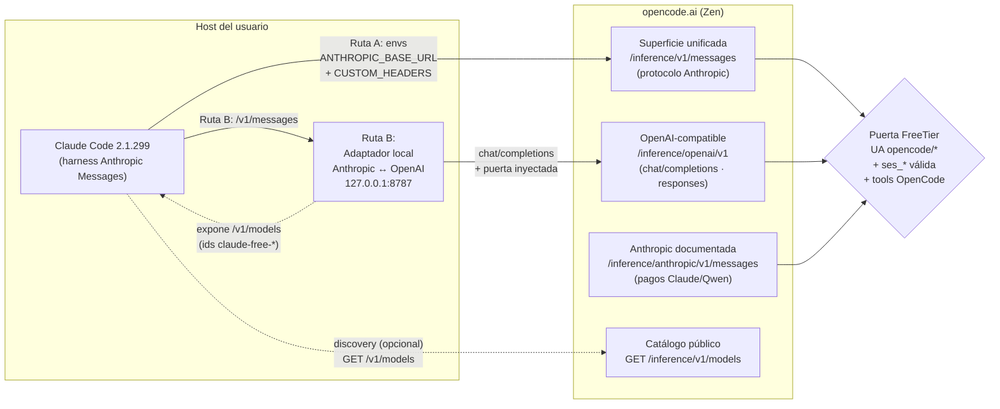
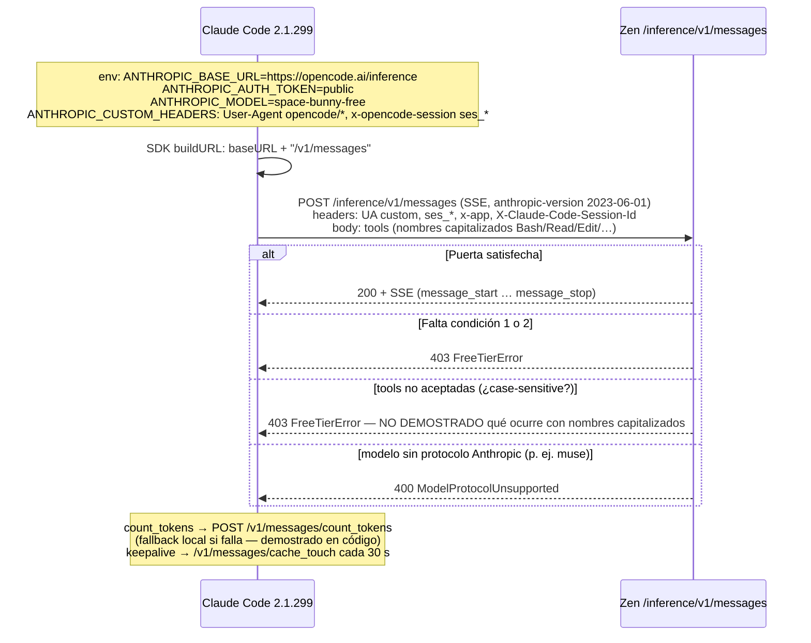
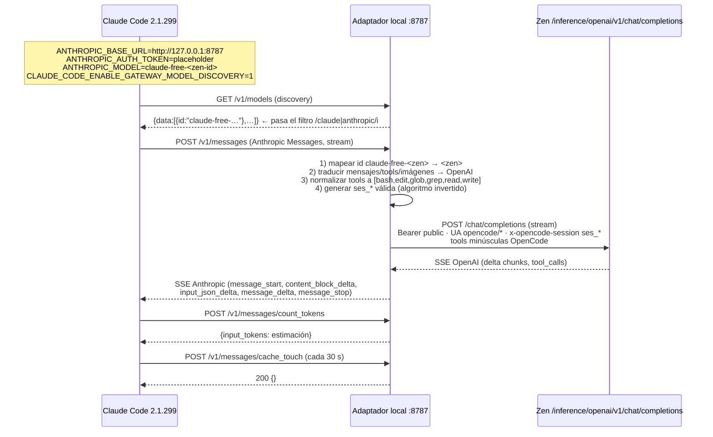
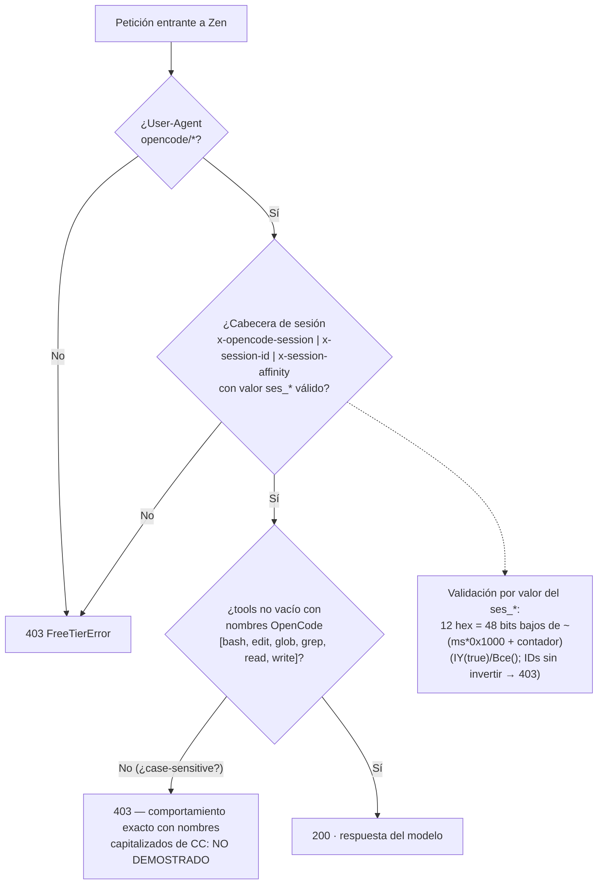
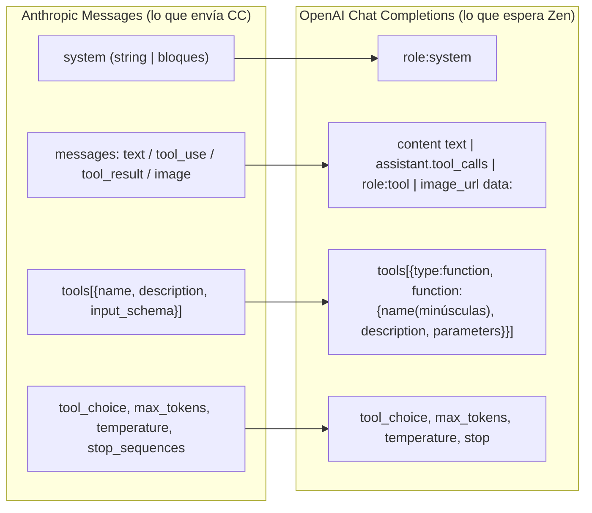
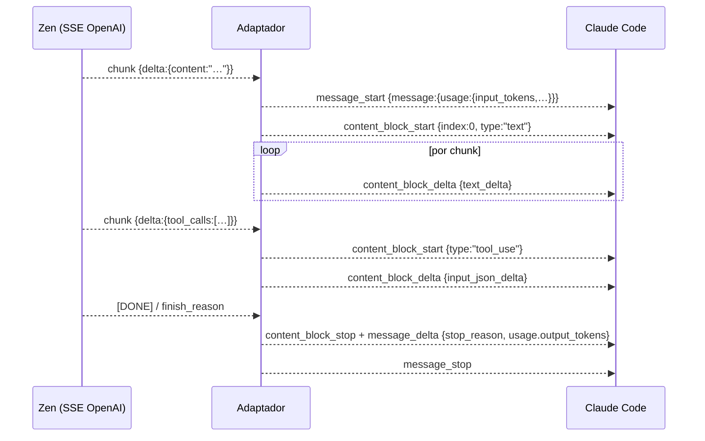
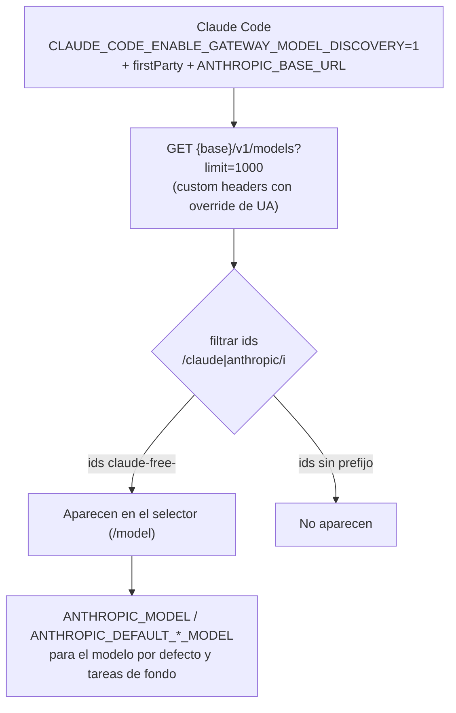

# Arquitectura

Este documento describe la arquitectura de las dos rutas de integración y los flujos de petición/respuesta. Todos los diagramas son **diseño**; el estado de demostración de cada pieza está en `FINDINGS.md` y `EVIDENCE.md`.

## 1. Vista general

- **Ruta A**: Claude Code habla directo con la superficie unificada Anthropic de Zen, configurado solo con variables de entorno.
- **Ruta B**: Claude Code habla con el adaptador local (protocolo Anthropic nativo); el adaptador habla OpenAI-compatible con Zen e inyecta la puerta FreeTier.

## 2. Ruta A — secuencia (diseño)

## 3. Ruta B — secuencia (diseño)

## 4. Puerta FreeTier (común a ambas rutas)

Detalles de la puerta (demostrados en la misión previa, ver `artifacts/reports/INFORME-TRANSFORMER-OPENCODE-ZEN.md`):

- `Authorization` es **suprimible**.
- La IP, el TLS (OpenSSL vs BoringSSL), HTTP/1.1 vs 2, el contenido de `instructions` y el resto de cabeceras fueron descartados experimentalmente como factores.
- La interfaz mínima reutilizable: 3 constantes + 6 esquemas de tools, sin dependencias.

## 5. Traducción Anthropic Messages ↔ OpenAI (Ruta B)

### 5.1 Petición (Anthropic → OpenAI)

- `cache_control` se elimina en la traducción (Zen/OpenAI-compatible no lo usa).
- Los bloques `thinking` se descartan.
- Los nombres de tools se normalizan a minúsculas dentro del set OpenCode y se guarda el mapa inverso para la respuesta (las 6 tools por defecto de CC mapean 1:1: `Bash→bash`, `Read→read`, `Edit→edit`, `Glob→glob`, `Grep→grep`, `Write→write`).

### 5.2 Respuesta (SSE OpenAI → SSE Anthropic)

Mapeo de `finish_reason` → `stop_reason`:

| OpenAI | Anthropic |
|---|---|
| `stop` | `end_turn` |
| `tool_calls` | `tool_use` |
| `length` | `max_tokens` |

Mapeo de usage: `prompt_tokens → input_tokens`, `completion_tokens → output_tokens`; campos de caché a 0/ausentes.

## 6. Discovery de modelos (selector de Claude Code)

- El adaptador debe servir ids que contengan `claude` (p. ej. `claude-free-deepseek-v4.1-flash-free`).
- `opn()` (validación al cambiar de modelo) bloquea ids no reconocidos en la superficie `model_switch`; los descubiertos por gateway se asumen reconocidos (INFERIDO).
